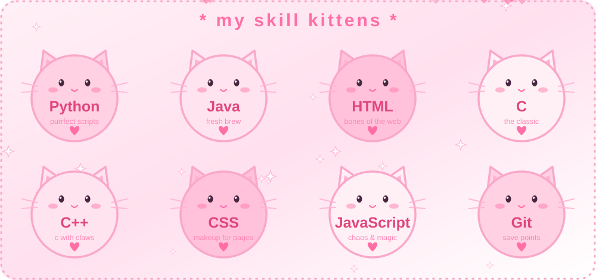

<div align="center">




```
  /\_/\
 ( o.o )   welcome to my little corner of github!
  > ^ <
```

</div>

## 🌸 about me

- 🎀 hi, i'm **Sathya**, and i love turning ideas into little programs
- 🐾 always learning, one commit at a time
- 🍥 fuelled by chai, pink playlists and cat videos
- 💌 happy to collaborate on anything cute, clever or creative

<div align="center">


## 🐱 my skills




## 💻 how i work




</div>

## 🍓 currently

| | |
|---|---|
| 🌷 **building** | something small and sweet |
| 📚 **learning** | one new thing every week |
| 🎧 **vibing to** | soft lo-fi beats |

## 🎀 fun facts

- my `git commit` messages are 40% emojis
- i name my variables after snacks
- if the code works, a cat gets treats

<div align="center">

### 💌 let's connect

[LinkedIn](https://linkedin.com/in/YOUR_LINKEDIN) · [Email](mailto:YOUR_EMAIL) · [Portfolio](https://YOUR_PORTFOLIO.com)


*made with 💖 and a lot of meows* 🐾

</div>
